# System Architecture

## End-to-end agent flow

```mermaid
flowchart LR
    A[Company Input] --> B[Question Generator]
    B --> C[Research Questions]
    C --> D[Retrieval & Storage Agent]
    D --> E[Tavily Search]
    E --> F[Question–Answer Pairs]
    F --> G[Embeddings]
    G --> H[(ChromaDB)]
    H --> I[Report Drafter]
    I --> J[Evidence Context]
    J --> K[LLM Report Generation]
    K --> L[Markdown Report]
```

## Orchestration

The LangGraph `StateGraph` uses a sequential path:

`START → run_question_generator → run_data_retrieval_storage → run_report_drafter → END`

Each node reads and updates `CompetitiveAnalysisState`. It contains the target company, sector, validation status, generated questions, research results, ChromaDB storage status, vector store reference, report, and error details. The state is implemented as a Pydantic model; the vector-store field permits a non-Pydantic object.

## Agent responsibilities

| Stage | Agent / node | Main tool or dependency | State output |
|---|---|---|---|
| 1 | Question Generator | `suggest_questions` | Sector, validity, question list |
| 2 | Data Retrieval & Storage | `fetch_search_results`, `store_in_chromadb` | Q&A results, insertion status |
| 3 | Report Drafter | Chroma retriever, `generate_report` prompt, LLM | Markdown report |

## Retrieval-augmented drafting

Valid search answers are embedded and stored as documents with question metadata. The report-drafting node retrieves relevant documents from ChromaDB and inserts their contents into a report prompt. This helps ground the generated analysis in collected research, but sources and claims still require human review.

## Boundaries

The diagram describes the implemented notebook workflow, not a production architecture. It does not imply a hosted service, live dashboard, automated source verification, or robust citation auditing.
