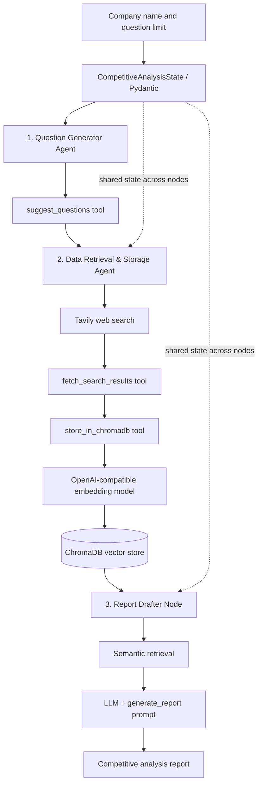

# Multi-Agent RAG Competitive Analysis

**Automated competitive intelligence using LangGraph, LangChain, Tavily Search, and ChromaDB.**

This proof-of-concept coordinates three specialized AI agents to research a company, store research evidence as vector embeddings, and draft a structured competitive analysis report. The demonstrated case study analyzes **Microsoft**.

> **Project status:** Working notebook prototype, validated in Google Colab. Research and generated recommendations should be independently verified before business use.

## Architecture

See [Architecture](docs/ARCHITECTURE.md) for the orchestration and data flow.

## What it does

- Validates a target company, identifies its sector, and proposes research questions.
- Uses Tavily to retrieve external competitive intelligence.
- Embeds and stores usable question–answer content in ChromaDB.
- Retrieves relevant evidence and generates an executive-ready report with a competitor comparison, SWOT analysis, and strategic recommendations.
- Tracks intermediate results and errors using a typed Pydantic state.

## Technology stack

| Component | Technology | Role |
|---|---|---|
| Orchestration | LangGraph `StateGraph` | Sequential agent workflow |
| Agents/tools | LangChain and LangGraph ReAct agents | Specialized research tasks |
| Web research | Tavily Search | External research |
| LLM | `gpt-4o-mini` via OpenAI-compatible API | Reasoning and report drafting |
| Embeddings | `text-embedding-3-small` | Vector representations |
| Vector store | ChromaDB | Evidence storage and semantic retrieval |
| Validation | Pydantic | Structured workflow state |
| Development | Python / Google Colab | Prototype execution |

## Example use case

**Input:** Microsoft; five competitive analysis questions.

**Output:** A Markdown report with executive summary, company and market overview, competitors, comparative analysis, SWOT, recommendations, and conclusion. Outputs are dynamically generated and may differ across runs.

## Running the prototype

1. Open `notebooks/Multi_Agent_RAG_Competitor_Analysis_Final.ipynb` in Google Colab after adding your cleaned notebook to this folder.
2. Install the packages from the notebook's setup cell (the notebook was built with version-pinned dependencies).
3. Configure Colab Secrets named `OPENAI_API_KEY` and `TAVILY_API_KEY`.
4. Set `OPENAI_BASE_URL` to an endpoint you are authorized to use. The original coursework used a course-provided endpoint, which may not be available to others; compatible model availability varies by provider.
5. Run the notebook from top to bottom. Review tool responses, stored document counts, and the generated report.

**Security:** Never commit real API keys, credentials, local ChromaDB data, or notebook outputs containing secrets. Review notebook metadata and saved outputs before publishing.

## Engineering considerations

- **Grounding:** The report prompt prioritizes retrieved evidence, but this is not a guarantee against hallucinations.
- **Reliability:** Search and API failures may result in missing evidence; review error states and stored counts.
- **Data quality:** Retrieved web answers should be checked for freshness, credibility, and provenance.
- **Reproducibility:** The course-specific endpoint and notebook environment may require adaptation for independent deployment.
- **Future enhancements:** Explicit source URL retention, citation validation, automated evaluation, retries, caching, and deployment as an API/UI.

## Documentation

- [Architecture and data flow](docs/ARCHITECTURE.md)
- [Technical explanation and design decisions](docs/TECHNICAL_EXPLANATION.md)

## Portfolio relevance

Demonstrates **agentic AI orchestration, RAG, vector search, tool calling, prompt engineering, state management, and end-to-end debugging** in a business-facing use case.

## Disclaimer

Educational proof-of-concept. The generated report is not investment advice and should not be treated as independently verified market research.
